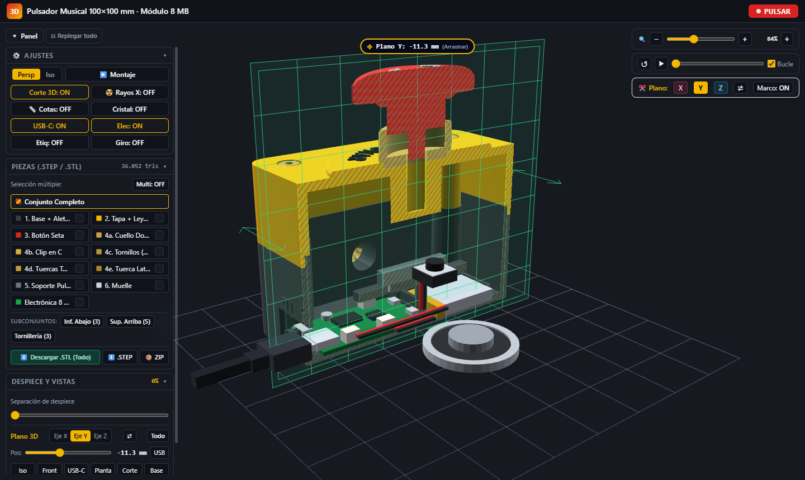
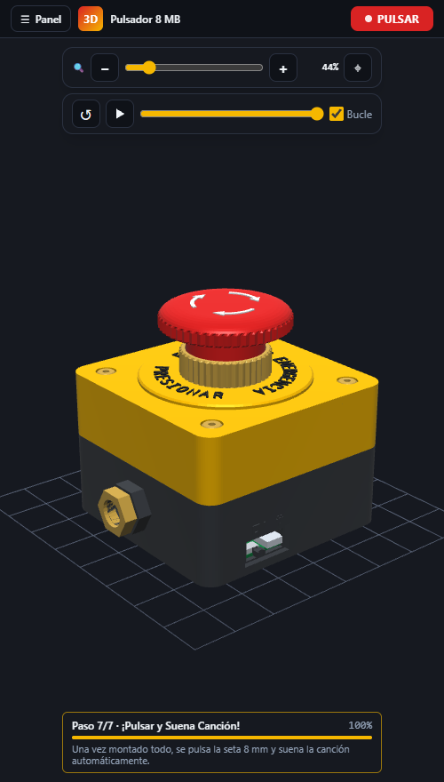

# 🔴🟡 Botón de Emergencia Musical 3D — Proyecto Interactivo (Impresión 3D + IA)

<p align="center">
  <strong>Una broma convertida en producto real imprimible en 3D + visor CAD interactivo en WebGL,<br/>
  diseñado y programado de principio a fin conversando con IA — sin usar programas de CAD ni saber programar.</strong>
</p>

<p align="center">
  <a href="https://boton-mercadona-3d.netlify.app/">
    <strong>🚀 PROBAR EN VIVO (Netlify)</strong>
  </a>
  &nbsp;·&nbsp;
  <a href="https://jmcaamanog.github.io/BOTON_3D_INTERACTIVO/">
    <strong>🌐 Visor en GitHub Pages</strong>
  </a>
  <br/>
  <a href="https://jmcaamanog.github.io/BOTON_3D_INTERACTIVO/?demo=corte">✂️ Corte 3D</a>
  &nbsp;·&nbsp;
  <a href="https://jmcaamanog.github.io/BOTON_3D_INTERACTIVO/?demo=rayosx">☢️ Rayos X</a>
  &nbsp;·&nbsp;
  <a href="https://jmcaamanog.github.io/BOTON_3D_INTERACTIVO/?demo=despiece">💥 Despiece</a>
  &nbsp;·&nbsp;
  <a href="./stl.zip">📦 Descargar STL (.zip)</a>
</p>

---

## 🎯 ¿De qué va este proyecto?

Todo empezó como **una broma para hacer un regalo original**: construir un botón industrial de emergencia de `100 × 100 × 102 mm` (impreso en 3D multicolor) que, al pulsarlo, **suene la mítica canción de Mercadona** usando un módulo de sonido grabable de 8 MB comprado online.

Más allá de la broma, el objetivo de guardar y compartir este repositorio es **didáctico y divulgativo**: demostrar que hoy cualquier persona —**sin instalar Fusion 360, Blender ni SolidWorks, y sin conocimientos previos de programación**— puede partir de unas simples fotos con las medidas de una placa electrónica y acabar con:
1. **Piezas mecánicas 3D reales y verificadas (`.STEP` y `.STL` cerrados *watertight*)** adaptadas al milímetro a la electrónica real.
2. **Un visor 3D profesional en un solo archivo `index.html`** con montaje animado paso a paso, sonido integrado, corte de sección macizo arrastrable, modo Rayos X, regla de medición 3D y descarga directa de piezas imprimibles — listo para abrir en **PC, Android o iPhone**.

---

## 📸 Capturas reales del visor 3D interactivo

### 1. Conjunto completo y controles flotantes replegables
Diseño limpio a pantalla completa con paneles flotantes replegables (`⚙ Ajustes`, `Piezas`, `Despiece y Vistas`, `Información Detallada`), perímetro amarillo únicamente en controles activos, zoom suave (`44%` inicial) y botón **`PULSAR`** con sonido real integrado.

[](https://jmcaamanog.github.io/BOTON_3D_INTERACTIVO/?demo=completo)
*👉 [Probar esta vista en vivo](https://jmcaamanog.github.io/BOTON_3D_INTERACTIVO/?demo=completo)*

---

### 2. Corte 3D macizo con plano arrastrable en 3 ejes (X / Y / Z)
Sección maciza con rayado CAD a 45° (*WebGL Stencil Buffer Capping*) y plano 3D interactivo que puedes arrastrar directamente con el ratón o el dedo. En la captura se aprecia el corte justo por el eje del **puerto USB-C** con el cable enchufado desde el exterior, la **placa PCB de 47×25 mm** y la **batería LiPo**.

[](https://jmcaamanog.github.io/BOTON_3D_INTERACTIVO/?demo=corte)
*👉 [Probar el Corte 3D en vivo](https://jmcaamanog.github.io/BOTON_3D_INTERACTIVO/?demo=corte)*

---

### 3. Modo Rayos X (Lupa interactiva y vista Global holográfica)
Permite ver a través de la carcasa para inspeccionar cómo encajan el **altavoz Ø35 mm** (bajo las 5 ranuras acústicas), la **batería LiPo `30×20×5 mm`**, el **módulo 8 MB**, el **pulsador `12×12 mm`** y todo el cableado interior.

[](https://jmcaamanog.github.io/BOTON_3D_INTERACTIVO/?demo=rayosx)
*👉 [Probar Modo Rayos X en vivo](https://jmcaamanog.github.io/BOTON_3D_INTERACTIVO/?demo=rayosx)*

---

### 4. Despiece completo, cotas CAD 3D y regla punto a punto
Separa todas las piezas en el espacio con el deslizador de **Despiece**, muestra las cotas exteriores e interiores en 3D o usa la **Regla 2-Pts** para medir la distancia exacta en milímetros entre dos puntos cualquiera del modelo.

[](https://jmcaamanog.github.io/BOTON_3D_INTERACTIVO/?demo=despiece)
*👉 [Probar Despiece y Cotas en vivo](https://jmcaamanog.github.io/BOTON_3D_INTERACTIVO/?demo=despiece)*

---

### 5. Referencia integrada de la electrónica real (`VER`)
Al seleccionar **`Electrónica 8 MB`** en `Piezas`, aparece el botón **`VER`** en `Información Detallada` que despliega sobre el propio 3D las 3 fotografías reales con las cotas exactas, patillaje y datos de carga del módulo `LJY-YYH-V1`.

[](https://jmcaamanog.github.io/BOTON_3D_INTERACTIVO/?demo=electronica)
*👉 [Probar ficha de Electrónica en vivo](https://jmcaamanog.github.io/BOTON_3D_INTERACTIVO/?demo=electronica)*

---

### 6. Experiencia nativa en móvil (Android e iPhone)
El mismo archivo `index.html` detecta pantallas móviles (`< 768 px`), repliega el panel en el botón **`☰ Panel`**, adapta los controles táctiles al ancho de pantalla, activa **pellizco con 2 dedos** para zoom/pan, **desbloqueo automático de audio** y **vibración háptica** en Android al pulsar el botón rojo.

<p align="center">
  <a href="https://jmcaamanog.github.io/BOTON_3D_INTERACTIVO/">
    
  </a>
</p>

---

## 🛠️ Electrónica utilizada y mejoras de diseño 3D

Toda la caja interior fue rediseñada a partir de las medidas reales del **Módulo de Sonido Grabable 8 MB (`LJY-YYH-V1`)**:
- **PCB**: `47.0 × 25.0 × 1.6 mm` con **ventana lateral derecha abocinada** para enchufar el cable **USB-C** y acceder al interruptor `ON/OFF` sin desmontar la caja.
- **Iconos exteriores en relieve** (`USB` + `I / O`) y **aleta ergonómica de clic (`Aleta_Click_ON_OFF`)** para accionar el interruptor `ON/OFF` desde fuera con el dedo.
- **Altavoz `8 Ω / 0.5 W` (`Ø35.0 mm`)** alojado en su cuna circular norte frente a las 5 ranuras acústicas.
- **Batería LiPo `X502030` (`30.0 × 20.0 × 5.0 mm`, `200 mAh`)** en su cuna suroeste con salida de cableado.
- **Pulsador táctil `12.0 × 12.0 mm`** en soporte interior con brazos elásticos flexibles y canal de cables.
- **Cierre completo**: 4 tornillos avellanados de esquina + sus **4 tuercas hexagonales M4** + tuerca hexagonal lateral + muelle helicoidal imprimible (carrera de `8.0 mm`).

---

## 🖨️ Archivos listos para imprimir en 3D

Todos los archivos han sido verificados como **mallas 2-manifold cerradas (*watertight*, 0 aristas abiertas)** y sólidos `.STEP` válidos:

| Pieza | Archivo CAD (`.STEP`) | Archivo Malla (`.STL`) | Filamento sugerido |
| :--- | :--- | :--- | :--- |
| **Conjunto completo** | [step/boton_emergencia_conjunto_completo.step](step/boton_emergencia_conjunto_completo.step) | [stl.zip](stl.zip) *(los 10 STL)* | Multicolor (4 colores) |
| **1. Base + Aleta/Iconos** | [step/1_base_inferior_gris.step](step/1_base_inferior_gris.step) | [stl/1_base_inferior_gris.stl](stl/1_base_inferior_gris.stl) | PLA/PETG Gris Antracita |
| **2. Tapa + Leyenda** | [step/2_tapa_superior_amarilla.step](step/2_tapa_superior_amarilla.step) | [stl/2_tapa_superior_amarilla.stl](stl/2_tapa_superior_amarilla.stl) | Amarillo + Negro |
| **3. Botón Seta + Flechas** | [step/3_boton_seta_rojo.step](step/3_boton_seta_rojo.step) | [stl/3_boton_seta_rojo.stl](stl/3_boton_seta_rojo.stl) | Rojo + Blanco |
| **4. Cuello, Clip, Tornillos y Tuercas** | [step/4_cuello_estriado_y_accesorios.step](step/4_cuello_estriado_y_accesorios.step) | [stl/4_cuello_estriado_y_accesorios.stl](stl/4_cuello_estriado_y_accesorios.stl) | Dorado / Plata (PLA Silk/PETG) |
| **5. Soporte Pulsador Interior** | [step/5_soporte_pulsador_interior.step](step/5_soporte_pulsador_interior.step) | [stl/5_soporte_pulsador_interior.stl](stl/5_soporte_pulsador_interior.stl) | PETG Gris *(brazos flexibles)* |
| **6. Muelle Imprimible** | [step/6_muelle_imprimible.step](step/6_muelle_imprimible.step) | [stl/6_muelle_imprimible.stl](stl/6_muelle_imprimible.stl) | PETG / Nylon *(o acero Ø20×22 mm)* |

> **Tip**: También puedes seleccionar cualquier pieza (o varias a la vez) dentro del propio [visor 3D online](https://jmcaamanog.github.io/BOTON_3D_INTERACTIVO/) y pulsar **`⬇ Descargar .STL`** para generar al instante el archivo listo para imprimir apoyado en cama (`Z = 0`).

---

## 💻 Uso en local y documentación técnica para aprender

- **Abrir en tu ordenador (sin internet)**: descarga [index.html](index.html) (`4,67 MB`) y haz **doble clic**. Incluye embebidos el motor WebGL, Tailwind CSS, las 27 mallas 3D, la canción MP3 y las 3 fotos de electrónica.
- **Abrir en Android o iPhone**: entra directamente en **[https://boton-mercadona-3d.netlify.app/](https://boton-mercadona-3d.netlify.app/)** (o en el espejo de GitHub Pages: **[https://jmcaamanog.github.io/BOTON_3D_INTERACTIVO/](https://jmcaamanog.github.io/BOTON_3D_INTERACTIVO/)**). En Chrome (Android) o Safari (iPhone) puedes usar *"Añadir a pantalla de inicio"* para tenerlo como app.
- **¿Quieres saber cómo funciona por dentro y cómo crear o publicar proyectos parecidos?** Lee la guía completa paso a paso en **[GUIA_PROYECTO.md](GUIA_PROYECTO.md)** (arquitectura WebGL/GLSL, Stencil Buffer, exportación CAD, publicación en Netlify Drop y GitHub Pages, y checklist de QA móvil).

---

## 📁 Estructura del repositorio

```text
BOTON_3D_INTERACTIVO/
├── index.html          ← Visor 3D universal (PC + Android + iPhone, 100% autocontenido)
├── manifest.json       ← Manifiesto PWA para instalación en móvil
├── README.md           ← Presentación visual del proyecto
├── GUIA_PROYECTO.md    ← Guía didáctica y técnica detallada para futuros proyectos
├── stl.zip             ← Paquete con todos los archivos .STL imprimibles
├── capturas/           ← Capturas reales del visor en PC y móvil
├── step/               ← Modelos CAD paramétricos (.STEP AP214)
├── stl/                ← Mallas triangulares (.STL) listas para laminar
└── recursos/           ← Fotos originales de la electrónica, boceto y audio MP3
```
