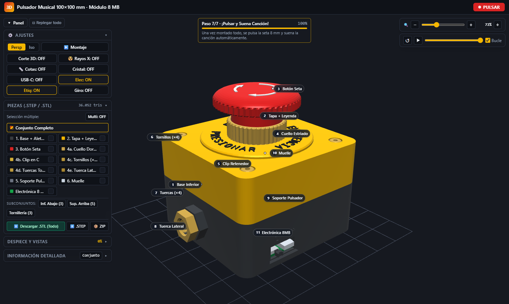
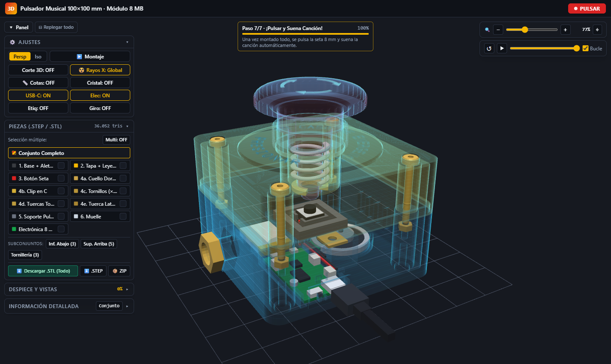
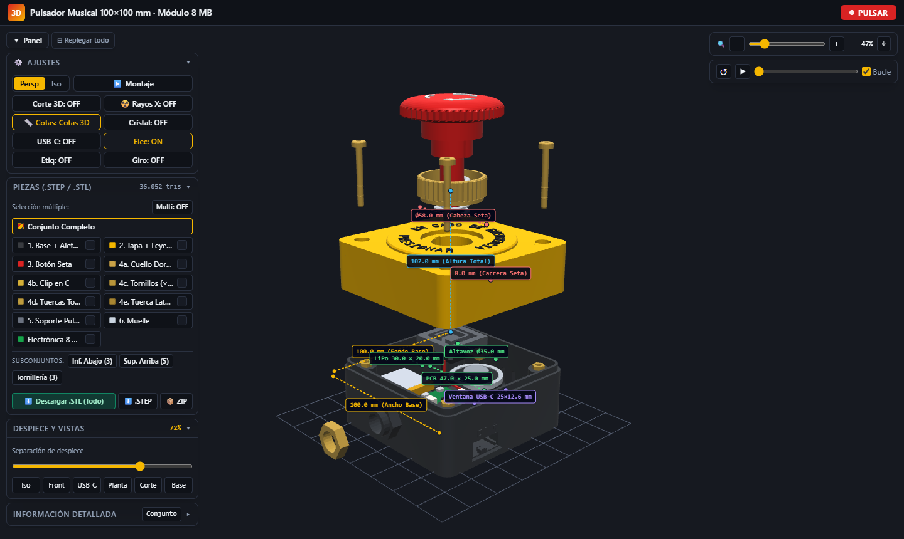
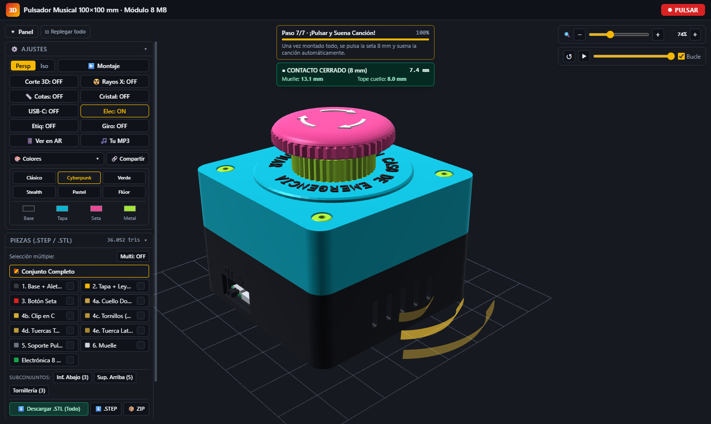
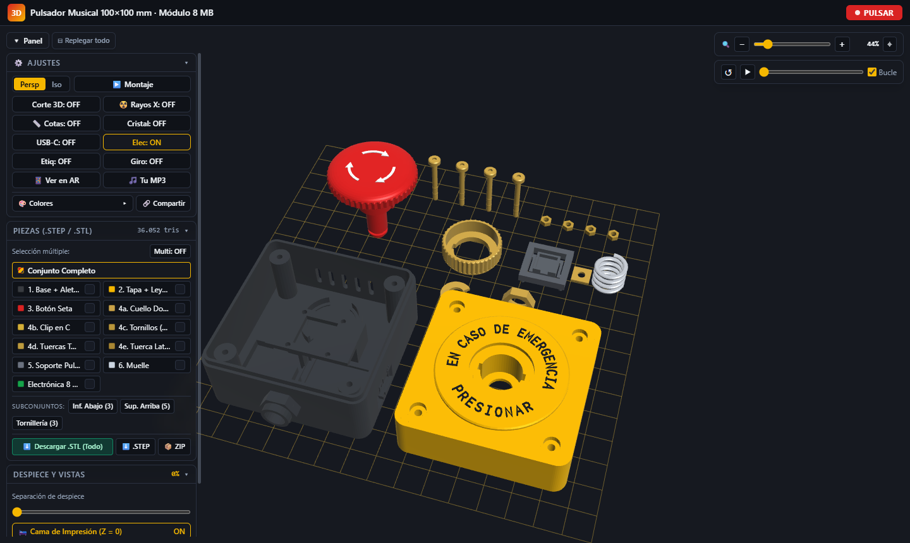
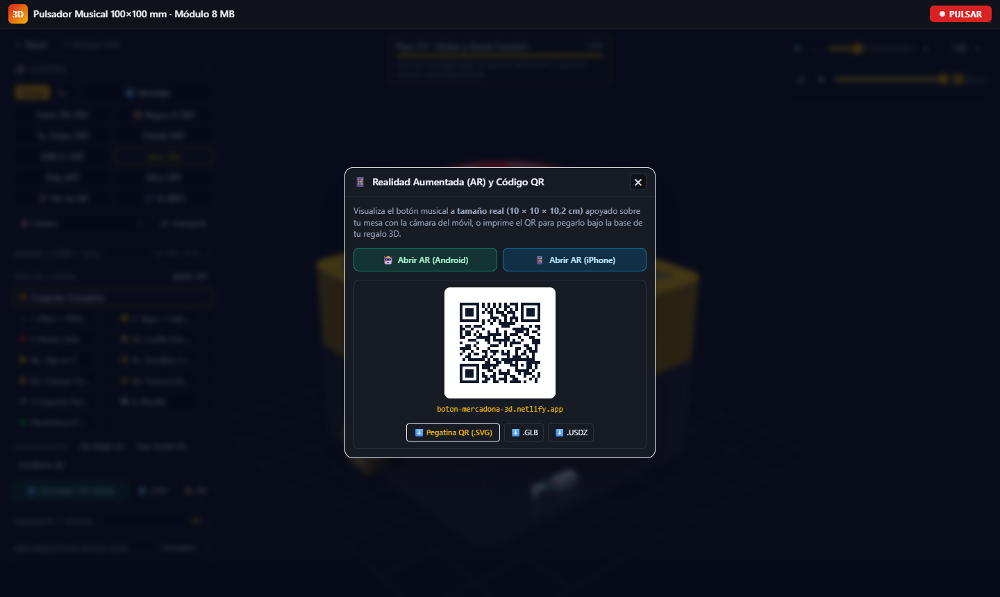
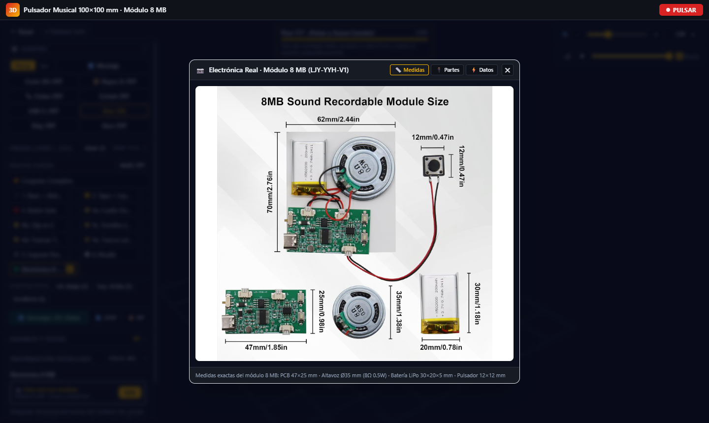

# 🔴🟡 Botón de Emergencia Musical 3D — Proyecto Interactivo (Impresión 3D + IA)

<p align="center">
  <strong>Una broma convertida en producto real imprimible en 3D + visor CAD interactivo en WebGL + Realidad Aumentada,<br/>
  diseñado y programado de principio a fin conversando con IA — sin usar programas de CAD ni saber programar.</strong>
</p>

<p align="center">
  <a href="https://boton-mercadona-3d.netlify.app/">
    <strong>🚀 PROBAR EN VIVO (PC · Android · iPhone)</strong>
  </a>
  &nbsp;·&nbsp;
  <a href="https://jmcaamanog.github.io/BOTON_3D_INTERACTIVO/">
    <strong>🌐 Espejo GitHub Pages</strong>
  </a>
  <br/>
  <a href="https://boton-mercadona-3d.netlify.app/?demo=corte">✂️ Corte 3D</a>
  &nbsp;·&nbsp;
  <a href="https://boton-mercadona-3d.netlify.app/?demo=rayosx">☢️ Rayos X</a>
  &nbsp;·&nbsp;
  <a href="https://boton-mercadona-3d.netlify.app/?demo=despiece">💥 Despiece</a>
  &nbsp;·&nbsp;
  <a href="https://boton-mercadona-3d.netlify.app/?demo=cama">🛏️ Cama 3D</a>
  &nbsp;·&nbsp;
  <a href="https://boton-mercadona-3d.netlify.app/?demo=ondas&pal=cyberpunk">🎨 Colores + Ondas</a>
  &nbsp;·&nbsp;
  <a href="https://boton-mercadona-3d.netlify.app/?demo=ar">📱 Ver en AR</a>
  &nbsp;·&nbsp;
  <a href="./stl.zip">📦 Descargar STL (.zip)</a>
</p>

---

## 🎯 ¿De qué va este proyecto?

Todo empezó como **una broma para hacer un regalo original**: fabricar un botón industrial de emergencia de `100 × 100 × 102 mm` (impreso en 3D multicolor) que, al pulsarlo, **suene la mítica canción de Mercadona** usando un módulo de sonido grabable de 8 MB comprado online.

Además de la broma, este repositorio tiene un fin **divulgativo y didáctico**: demostrar que hoy cualquiera —**sin instalar Fusion 360, Blender ni SolidWorks, y sin conocimientos previos de programación**— puede partir de unas simples fotos con medidas de una placa electrónica y acabar con:
1. **Piezas mecánicas 3D reales y verificadas (`.STEP` y `.STL` cerrados *watertight*)** adaptadas al milímetro a la electrónica real.
2. **Un visor 3D profesional en un solo archivo `index.html`** con montaje animado paso a paso, sonido integrado (¡y probador con tu propio MP3!), corte macizo arrastrable, modo Rayos X, configurador de colores en vivo, vista de cama de impresión, **Realidad Aumentada (AR)** y descarga directa de piezas listas para imprimir.

---

## 🧠 Cómo se creó este proyecto con IA en 5 pasos (sin CAD ni programar)

| Paso | Qué aportó el humano | Qué generó y verificó la IA |
| :--- | :--- | :--- |
| **1. Idea y fotos reales** | Una foto de inspiración ([boton.jpeg](recursos/boton.jpeg)), la canción MP3 y 3 fotos de Amazon con las cotas reales del módulo de 8 MB. | Extracción exacta de cotas (`PCB 47×25 mm`, `Altavoz Ø35 mm`, `LiPo 30×20×5 mm`, `Pulsador 12×12 mm`). |
| **2. Rediseño CAD 3D** | Requisitos claros en lenguaje natural: *"que quepa todo, se pueda cargar por USB-C desde fuera, añadir iconos en relieve, aleta ON/OFF y 4 tuercas"*. | Generación paramétrica de sólidos `.STEP` y `.STL` con holguras de impresión (`+0.3/+0.8 mm`) y validación topológica 100% *watertight* (`0` huecos). |
| **3. Visor 3D WebGL interactivo** | Peticiones de experiencia visual: corte macizo con plano arrastrable, Rayos X, orden exacto de montaje, colores, ondas sonoras, cama 3D y botón `VER`. | Programación en WebGL 1.0 + GLSL (Stencil Buffer, Raycasting, generador binario STL en navegador) todo en 1 archivo offline. |
| **4. AR, QR y QA Multiplataforma** | *"Quiero poder mandárselo a amigos en móvil con sonido y todo, y que quede bien guardado."* | Modelos AR nativos (`.glb` + `.usdz`), código QR imprimible, diseño adaptable PC/Android/iPhone y pruebas automatizadas en resoluciones reales. |
| **5. Publicación automática** | Subir a GitHub y enlazar con Netlify en 1 clic. | Despliegue automático continuo en **Netlify** y **GitHub Pages** con tarjeta de vista previa para WhatsApp (`og:image`). |

---

## 📸 Galería real de funciones del visor 3D

### 1. Conjunto completo y paneles flotantes replegables
[](https://boton-mercadona-3d.netlify.app/?demo=completo)
*👉 [Abrir vista completa](https://boton-mercadona-3d.netlify.app/?demo=completo) · Paneles flotantes replegables, perímetro amarillo solo en controles activos, Zoom suave (`44%`) y botón **`PULSAR`** con sonido.*

---

### 2. Corte 3D macizo con plano arrastrable en 3 ejes (X / Y / Z)
[](https://boton-mercadona-3d.netlify.app/?demo=corte)
*👉 [Probar Corte 3D en vivo](https://boton-mercadona-3d.netlify.app/?demo=corte) · Sección maciza con rayado CAD 45° (WebGL Stencil Buffer), tirador superior arrastrable directamente en 3D y simulación de cable USB-C enchufado.*

---

### 3. Modo Rayos X (Lupa circular interactiva y Global holográfico)
[](https://boton-mercadona-3d.netlify.app/?demo=rayosx)
*👉 [Probar Modo Rayos X en vivo](https://boton-mercadona-3d.netlify.app/?demo=rayosx) · Carcasa holográfica translúcida mostrando el muelle, los 4 tornillos con sus 4 tuercas, PCB 8 MB, altavoz Ø35 mm, batería LiPo y pulsador 12×12 mm.*

---

### 4. Despiece completo, cotas CAD 3D y regla punto a punto
[](https://boton-mercadona-3d.netlify.app/?demo=despiece)
*👉 [Probar Despiece y Cotas en vivo](https://boton-mercadona-3d.netlify.app/?demo=despiece) · Despiece progresivo, cotas CAD 3D proyectadas y Regla 2-Pts para medir milímetros reales entre dos puntos cualquiera.*

---

### 5. Configurador de colores en vivo + Ondas acústicas 3D + Tu propio MP3
[](https://boton-mercadona-3d.netlify.app/?demo=ondas&pal=cyberpunk)
*👉 [Probar Colores y Ondas 3D en vivo](https://boton-mercadona-3d.netlify.app/?demo=ondas&pal=cyberpunk) · 6 paletas instantáneas + 4 selectores de color libre para previsualizar filamentos, ondas sonoras 3D saliendo por las 5 ranuras del altavoz y botón **`🎵 Tu MP3`** (100% local en tu dispositivo).*

---

### 6. Vista "Cama de Impresión (Z = 0)" estilo laminador
[](https://boton-mercadona-3d.netlify.app/?demo=cama)
*👉 [Probar Vista Cama 3D en vivo](https://boton-mercadona-3d.netlify.app/?demo=cama) · Coloca automáticamente todas las piezas imprimibles planas sobre una cama virtual de `256 × 256 mm` para comprobar su orientación sin soportes.*

---

### 7. Realidad Aumentada (AR en tu mesa) y Pegatina QR para el regalo
[](https://boton-mercadona-3d.netlify.app/?demo=ar)
*👉 [Abrir AR y QR en vivo](https://boton-mercadona-3d.netlify.app/?demo=ar) · Lanza AR nativa a escala real `10 × 10 × 10,2 cm` en **Android (ARCore `.glb`)** y **iPhone (Quick Look `.usdz`)**, e incluye la **[pegatina QR lista para imprimir (SVG)](recursos/qr_regalo_boton_3d.svg)** para pegar bajo la base del regalo físico.*

---

### 8. Ficha de Electrónica real (`VER`) y experiencia nativa en Móvil
| Ficha con medidas reales (`VER`) | Vista nativa en móvil (Android e iPhone) |
| :---: | :---: |
| [](https://boton-mercadona-3d.netlify.app/?demo=electronica) | <a href="https://boton-mercadona-3d.netlify.app/"></a> |
| *[Ver medidas de la electrónica en vivo](https://boton-mercadona-3d.netlify.app/?demo=electronica)* | *Pellizco 2 dedos · Vibración háptica Android · Audio iOS/Android* |

---

## 🛒 Lista de materiales (BOM) y presupuesto estimado

| Componente | Especificación exacta | Coste aprox. |
| :--- | :--- | :---: |
| **Módulo de sonido grabable 8 MB** | Placa `LJY-YYH-V1` (USB-C + switch ON/OFF) + altavoz `Ø35 mm` (`8 Ω / 0.5 W`) + batería LiPo `30×20×5 mm` (`200 mAh`) + pulsador `12×12 mm` | ~7 – 10 € |
| **Filamento PLA / PETG (4 colores)** | ~140 g totales (Gris ~62 g · Amarillo ~48 g · Rojo ~22 g · Dorado/Blanco ~8 g) | ~3 – 4 € |
| **Cable USB-A a USB-C** | Para cargar la batería y copiar tu `.mp3` desde el PC sin abrir la caja | (Reutilizado) |
| **Muelle metálico *(opcional)*** | El proyecto incluye muelle imprimible; opcionalmente admite muelle acero `Ø20 × 22 mm` | 0 € (impreso) |
| **Total aproximado del regalo** | **Tiempo de impresión estimado**: ~5 – 6 h (capa `0.20 mm`, relleno `20%` Giroide) | **~10 – 14 €** |

---

## 🖨️ Archivos listos para imprimir y Realidad Aumentada

Todos los archivos CAD y de malla han sido verificados como **mallas 2-manifold cerradas (*watertight*, 0 errores)** y sólidos `.STEP` válidos:

| Pieza | CAD (`.STEP`) | Malla (`.STL`) | Filamento sugerido |
| :--- | :--- | :--- | :--- |
| **Conjunto completo** | [step/boton_emergencia_conjunto_completo.step](step/boton_emergencia_conjunto_completo.step) | [stl.zip](stl.zip) *(los 10 STL)* | Multicolor (4 colores) |
| **1. Base + Aleta ON/OFF + Iconos** | [step/1_base_inferior_gris.step](step/1_base_inferior_gris.step) | [stl/1_base_inferior_gris.stl](stl/1_base_inferior_gris.stl) | PLA/PETG Gris Antracita |
| **2. Tapa + Leyenda en relieve** | [step/2_tapa_superior_amarilla.step](step/2_tapa_superior_amarilla.step) | [stl/2_tapa_superior_amarilla.stl](stl/2_tapa_superior_amarilla.stl) | Amarillo + Negro |
| **3. Botón Seta + Flechas** | [step/3_boton_seta_rojo.step](step/3_boton_seta_rojo.step) | [stl/3_boton_seta_rojo.stl](stl/3_boton_seta_rojo.stl) | Rojo + Blanco |
| **4. Cuello, Clip, 4 Tornillos y 4 Tuercas** | [step/4_cuello_estriado_y_accesorios.step](step/4_cuello_estriado_y_accesorios.step) | [stl/4_cuello_estriado_y_accesorios.stl](stl/4_cuello_estriado_y_accesorios.stl) | Dorado / Plata (Silk/PETG) |
| **5. Soporte Pulsador Flexible** | [step/5_soporte_pulsador_interior.step](step/5_soporte_pulsador_interior.step) | [stl/5_soporte_pulsador_interior.stl](stl/5_soporte_pulsador_interior.stl) | PETG Gris *(brazos flexibles)* |
| **6. Muelle Imprimible** | [step/6_muelle_imprimible.step](step/6_muelle_imprimible.step) | [stl/6_muelle_imprimible.stl](stl/6_muelle_imprimible.stl) | PETG / Nylon |
| **Modelos AR + Pegatina QR** | [ar/boton_musical_3d.glb](ar/boton_musical_3d.glb) *(Android)* | [ar/boton_musical_3d.usdz](ar/boton_musical_3d.usdz) *(iPhone)* | [recursos/qr_regalo_boton_3d.svg](recursos/qr_regalo_boton_3d.svg) |

---

## 📷 Render 3D vs. Real impreso *(próximamente)*

> Cuando imprimas el botón físico y montes el módulo de 8 MB, solo tienes que añadir una foto tuya en `recursos/foto_real_impreso.jpg` para completar aquí el antes y después *"Diseño 3D con IA vs. Producto Real Impreso"*.

---

## 📚 Documentación técnica para aprender y replicar

- **Guía completa de arquitectura, flujo 3D/WebGL y publicación**: lee **[GUIA_PROYECTO.md](GUIA_PROYECTO.md)** para ver paso a paso cómo funciona el motor WebGL, el Stencil Buffer, el generador de STL binario en navegador, cómo publicar en Netlify + GitHub Pages y el checklist de QA móvil.
- **Uso sin internet en Ordenador**: descarga [index.html](index.html) (`4,75 MB`) y haz **doble clic**; funciona al 100% offline.

---

## 📁 Estructura del repositorio

```text
BOTON_3D_INTERACTIVO/
├── index.html          ← Visor 3D universal (PC + Android + iPhone, 100% autocontenido + OG card)
├── manifest.json       ← Manifiesto PWA para instalación en móvil como app
├── README.md           ← Presentación visual, BOM y guía didáctica del proyecto
├── GUIA_PROYECTO.md    ← Manual técnico detallado para futuros proyectos
├── stl.zip             ← Paquete con todos los archivos .STL imprimibles
├── ar/                 ← Modelos a escala real para Realidad Aumentada (.glb Android y .usdz iPhone)
├── capturas/           ← 9 capturas reales del visor en PC y móvil
├── step/               ← Los 7 modelos CAD paramétricos (.STEP AP214)
├── stl/                ← Los 10 archivos .STL individuales listos para laminar
└── recursos/           ← Fotos reales de la electrónica, pegatina QR imprimible (.svg), boceto y MP3
```
